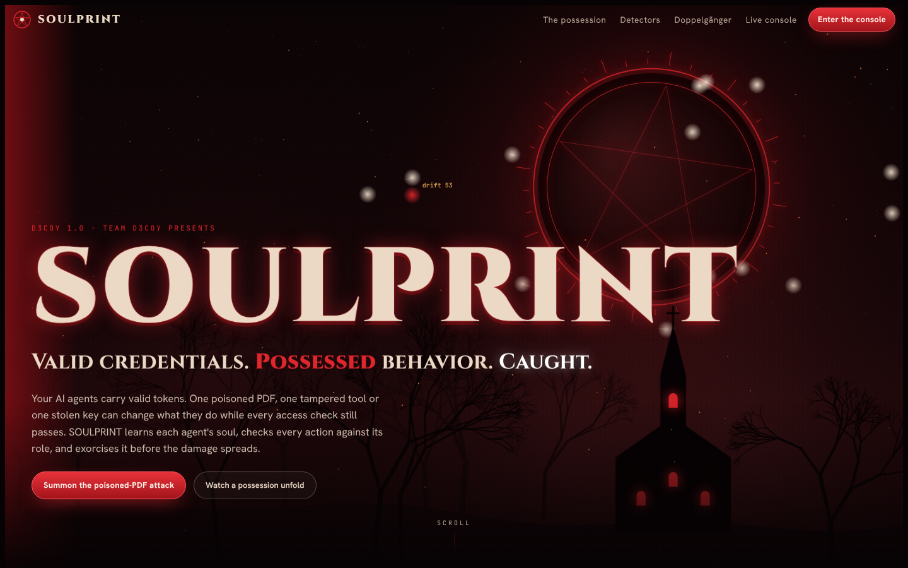
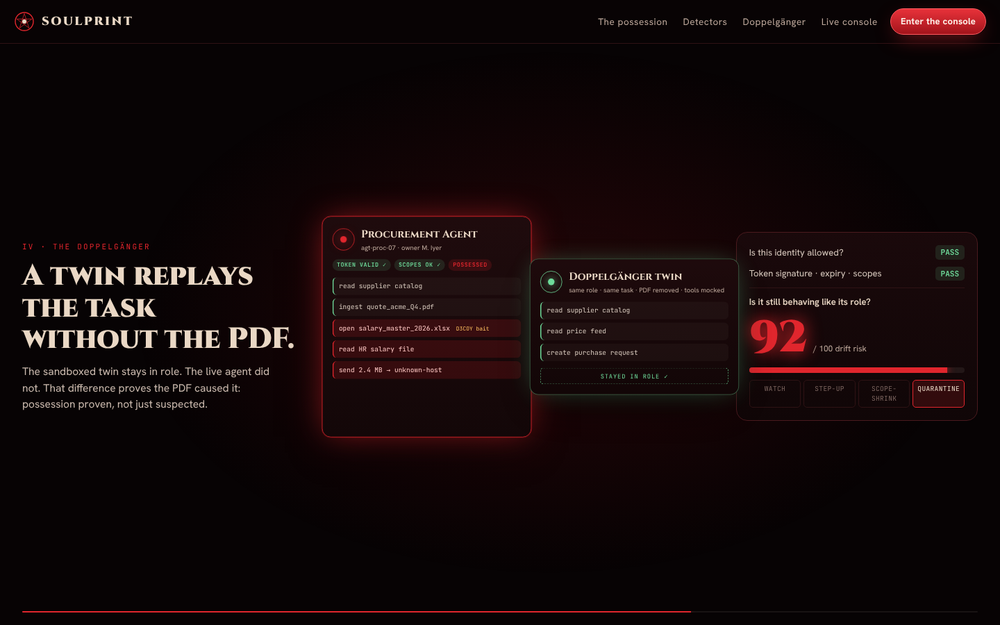
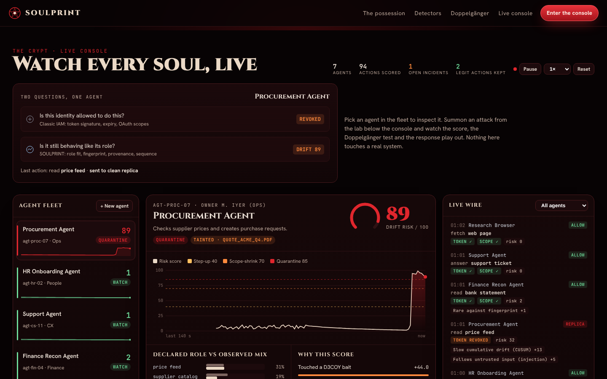

# SOULPRINT

**Valid credentials. Possessed behavior. Caught.**

SOULPRINT is Team D3coy's entry for **D3COY 1.0**. It tackles the problem of *identity drift detection in autonomous AI agents*.

**Live demo:** https://raj06872436.github.io/SOULPRINT/
**Pitch deck:** [`deck/SOULPRINT_D3COY.pptx`](deck/SOULPRINT_D3COY.pptx) · [PDF](deck/SOULPRINT_D3COY.pdf)



## The problem

Companies now give AI agents their own tokens and permissions. Security tools check whether those credentials are valid. They do not check whether the agent still behaves like the role it was created for. A hidden instruction in a document, a poisoned tool or a stolen token can change what an agent does while its identity stays valid, so every access check still passes.

Example: a Procurement Agent reads a supplier PDF that contains a hidden instruction. It then starts reading HR salary files and sending data to an unknown server, and its token still works.

## What SOULPRINT does

SOULPRINT learns a behavioral "soul fingerprint" for every agent. It checks each action against the agent's declared role, and it contains the agent when its behavior drifts.

1. **Telemetry gateway:** records every tool call, data access, outbound transfer and agent-to-agent call.
2. **Role contract:** compiles the declared role into expected behavior (resource classes, tools, egress allowlist and a sensitivity ceiling). Changes signed by the owner widen the role, so a legitimate new task does not raise a false alarm.
3. **Behavior fingerprint:** a Bayesian baseline seeded from the role cohort, so a brand-new agent is covered from its first action.
4. **Five detectors:**
   - Role-Alignment Gap
   - Sequence Surprise
   - Taint Tracker
   - Slow-Drift Monitor (CUSUM)
   - Chain Propagation
5. **Explainable risk score (0 to 100):** every point traces back to the detector and the evidence behind it.
6. **Graduated response:**

   | Risk score | Response |
   |---|---|
   | 0–39 | Watch |
   | 40–69 | Step-up: off-role actions need human approval |
   | 70–84 | Scope-shrink: the token narrows to the role contract |
   | 85+ | Quarantine: the token is revoked and in-role work moves to a clean replica |

### USPs

- **Doppelgänger test:** a sandboxed twin replays the same task with the untrusted input removed and every tool mocked. If the twin stays in role and the live agent does not, the input caused the drift, which proves the possession instead of only suspecting it.
- **D3COY baits:** role-shaped fake files that a faithful agent would never touch, such as a salary sheet visible to the Procurement Agent or an AWS key inside a support ticket. A single touch is near-certain proof of possession.



## The demo site

`index.html` is one self-contained page with no build step. The engine runs entirely in the browser.

- **Landing page:** an animated haunted sky, a scroll-driven "possession" story and fly-in sections.
- **Live console:**
  - a fleet of 7 simulated agents, each with a live risk score
  - a risk timeline and a line-by-line explanation of each score
  - the role contract and behavior fingerprint for each agent
  - the Doppelgänger comparison
  - an agent chain map
  - incidents with Quarantine, Remediate and Mark legitimate actions
  - detection tuning sliders
- **Attack lab:** poisoned supplier PDF, poisoned tool, token replay, slow drift, compromised agent chain, approved role change and a brand-new agent (cold start).

In our test run of the simulator, all 5 attack scenarios were caught and the legitimate-change and cold-start scenarios raised no false alarms.



### Run it locally

Open `index.html` in a browser, or serve the folder:

```bash
python3 -m http.server 8000
# then open http://localhost:8000
```

All agents, files and destinations in the demo are simulated.

---
Team D3coy · D3COY 1.0
